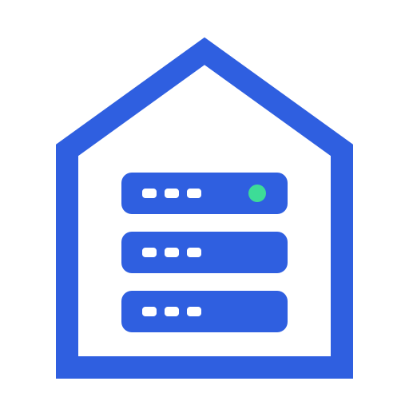
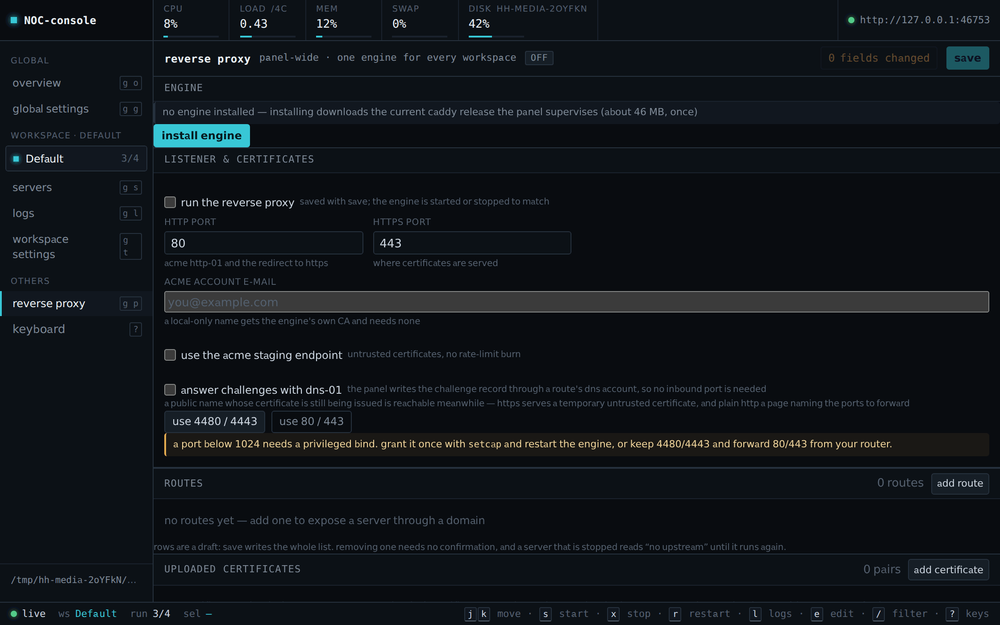

<div align="center">



# home-hosted

**The control panel for everything you self-host at home.**

<sub>The harness for your servers.</sub>

Point it at the things you run — a gateway, a media server, a bot, a database — and it starts them,
watches them, restarts what dies, and shows you one page of what is going on. Split them into
[workspaces](#-workspaces) when one panel holds more than one setup, and
[bring your own UI](#-bring-your-own-ui-byou) when you want one that fits you exactly.

[](https://www.npmjs.com/package/home-hosted)
[](https://www.npmjs.com/package/home-hosted)
[](https://github.com/NamesMT/home-hosted/actions/workflows/quickcheck.yml)
[](./LICENSE)
[](https://nodejs.org)

[🚀 Quick start](#-quick-start) · [🗂 Workspaces](#-workspaces) · [🧩 Servers](./docs/SERVERS.md) · [🤖 Agents & API](#-agents-scripts-and-your-own-tools) · [✨ Features](#-features) · [🛠 CLI](#-cli) · [🔔 Notifications](./docs/NOTIFICATIONS.md) · [🌐 Dynamic DNS](./docs/DDNS.md) · [💾 Backups](#-backups) · [🔀 Reverse proxy](./docs/REVERSE_PROXY.md) · [🔐 Security](#-security) · [🎨 BYOU](#-bring-your-own-ui-byou) · [❓ FAQ](#-faq)

</div>

---

<div align="center">



<sub>The stock panel, the [NOC console](./uis/noc-console) that ships alongside it, and UI directions
you could build yourself — <a href="#-bring-your-own-ui-byou">BYOU</a>.</sub>

</div>

---

## 🤔 Why?

You run a handful of services at home. The usual choices are extremes — 🧟 `tmux` sessions you
forget about, 📜 a hand-written systemd unit per service, or 🐳 a whole container orchestrator — plus
😩 the monitoring, the reboots and the day you move to a new machine.

🙂✨ home-hosted sits in between: declare a server once, and it is started, watched, restarted,
alerted on, backed up and shown on one page — whether it is a plain command or a `docker compose`
stack.

```text
                   ┌──────────────────────────────────────┐
   your browser ──▶│  home-hosted  ·  127.0.0.1:3999      │◀── scripts, agents, your own UI
                   │  UI + JSON API + live events (SSE)   │    (Bearer token, OpenAPI)
                   └───────────────┬──────────────────────┘
                                   │  supervises
        ┌──────────────────────────┼──────────────────────────┐
        ▼                          ▼                          ▼
   ┌─────────┐               ┌─────────┐                ┌─────────┐
   │ gateway │               │ files   │                │ bot     │
   │ :4000   │               │ :4010   │                │  ...    │
   └────┬────┘               └─────────┘                └─────────┘
        │ compose up                        restarts ↻ · health ✓ · logs · alerts
        ▼
   ┌────────────┬────────────┬────────────┐
   │  gateway   │  postgres  │   redis    │     + backups · DDNS · reverse proxy (HTTPS)
   └────────────┴────────────┴────────────┘
```

|  |  |
| --- | --- |
| ❌ **"Is it still running?"** | Health, CPU/memory, uptime and live logs per server |
| ❌ **Silent deaths** | Restarted automatically, and you are told — in the panel, Telegram or a webhook |
| ❌ **Fragile reboots** | `autostart` brings the stack back; one `down` stops it all cleanly |
| ❌ **"Move it to the new box"** | One archive — config **and** data — restored on a blank host |
| ✅ **home-hosted** | Declare it once, watch it forever |

It ships with **no servers configured**: a server is a command, its arguments and its environment.

```json
{ "id": "gateway", "command": "node", "args": ["server.js"], "port": 4000, "autostart": true }
```

---

## ⚡ Quick start

```bash
npx home-hosted            # start it — detached, it keeps running — and print the first-run password
npx home-hosted status     # where it is, what is running, the first-run password until you change it
npx home-hosted down       # stop the panel *and* everything it started
```

Open **<http://127.0.0.1:3999>**, sign in with the printed password, and change it under **Global
settings → Authentication**. <sub>Needs Node 24+. `pnpm dlx home-hosted …` works too.</sub>

<details>
<summary><b>📦 Install it instead of npx-ing it</b></summary>

```bash
npm install -g home-hosted      # or: pnpm add -g home-hosted
hh up                           # `hh` is the short name for `home-hosted`
```

Everything it owns lives under `$HHOSTED_HOME/.hh` (default `~/.home-hosted/.hh`). Delete that and
nothing of it is left behind.

</details>

<details>
<summary><b>📁 Keep a whole setup in a git repository</b></summary>

```bash
npx home-hosted init            # every step has a default; --yes takes them all
```

The project's scripts all pass `--home ./state`, and its `.gitignore` commits the server
definitions while keeping secrets, logs, TLS keys and archives local:

```jsonc
// package.json
{ "scripts": { "up": "home-hosted up --home ./state", "down": "home-hosted down --home ./state", "status": "home-hosted status --home ./state" } }
```

Clone, `pnpm install`, `pnpm run up` — the same setup on any machine with Node. Give each project its
own panel port (`control.port`, e.g. `4399`) so two can run side by side. Call it `pnpm run up`:
`pnpm up` is pnpm's own update command. Worked example:
**[hhosted-ai-pack](https://github.com/NamesMT/hhosted-ai-pack)**.

</details>

<details>
<summary><b>🧰 Start it at boot: systemd or Docker</b></summary>

```ini
[Unit]
Description=home-hosted
After=network-online.target

[Service]
User=youruser
WorkingDirectory=/srv/home-hosted
Environment=HHOSTED_HOME=/srv/home-hosted
ExecStart=/usr/local/bin/home-hosted up --foreground
Restart=always

[Install]
WantedBy=multi-user.target
```

> [!CAUTION]
> **Set `WorkingDirectory`.** Relative paths in your servers (`cwd`, `{projectDir}`, `dataEnvs`)
> resolve against the directory the panel starts in, and systemd starts in `/`. Docker does the same
> without `-w`. Or pin it with `HHOSTED_PROJECT`.

</details>

---

## 🤖 Agents, scripts and your own tools

Everything the panel does goes through one HTTP API — the stock UI is just one client of it. Get a
token, then plain HTTP:

```bash
home-hosted set-token --generate        # hh_9uA2… — printed once, only its hash is kept
                                        #   (or Global settings → Authentication → Generate token)

curl -H "Authorization: Bearer hh_…" http://127.0.0.1:3999/api/state
curl -H "Authorization: Bearer hh_…" -X POST 'http://127.0.0.1:3999/api/servers/gateway/restart?workspace=default'
curl -N -H "Authorization: Bearer hh_…" http://127.0.0.1:3999/api/events            # live SSE
home-hosted status --json                                                            # where everything is
```

Building in TypeScript? `import { createClient } from 'home-hosted/client'` — a ~3 KB client typed
from the panel's own routes, with the live event stream ([API.md](./docs/API.md#the-typescript-client)).
Any other language: `GET /openapi/spec.json` describes all of it (browse at `/openapi/ui`), so an
OpenAPI generator gives you a typed client. `GET /healthz` needs no credential and is `503` while any server needs attention —
point your uptime monitor at it.

> [!WARNING]
> **A token is full admin.** It can create and start server entries, which run commands as the
> panel's user. Keep it like a password; rotate with `set-token --generate`.

<details>
<summary><b>🌐 The endpoints worth knowing</b></summary>

✅ takes `?workspace=<id>` (omitted = the default workspace); ❌ is panel-wide.

| | | |
| --- | --- | --- |
| `GET /api/state` | the full snapshot: settings, every workspace and server, host vitals | ❌ |
| `GET /api/events` | SSE: `hello` (full state), then `state`, `server`, `log`, `ping` | optional |
| `GET`/`POST /api/workspaces`, `PATCH`/`DELETE /api/workspaces/:id` | the workspace registry | ❌ |
| `GET`/`POST /api/servers`, `GET`/`PUT`/`PATCH`/`DELETE /api/servers/:id` | entries — `PUT` is create-or-replace, so a re-run converges | ✅ |
| `POST /api/servers/:id/{start,stop,restart,free-port}`, `/api/servers/{start-all,stop-all}` | lifecycle | ✅ |
| `GET /api/servers/:id/logs`, `/api/servers/:id/stream`, `/api/logs/:id` | buffered lines, one server's SSE, files on disk | ✅ |
| `GET`/`PATCH /api/settings`, `GET`/`PATCH /api/settings/workspace` | panel-wide / per-workspace settings | ❌ / ✅ |
| `/api/backups`, `/api/proxy`, `/api/ddns`, `/api/notifications/…` | backups, reverse proxy, dynamic DNS, alerts | ❌ ❌ ✅ ✅ |
| `GET /api/metrics` | Prometheus text, with a bearer token | ❌ |
| `GET /healthz` | no credential needed — for your monitor | ❌ |

Every error is one envelope — `{ "message", "code", "detail"? }` — with a stable `code` to branch on.
Undeclared query keys are refused (`400`), so a typo like `?worspace=` never acts on the default
workspace. Full reference, SSE frames, metrics and compatibility rules: **[API.md](./docs/API.md)**.

</details>

<details>
<summary><b>🧑‍💻 Pointing an AI agent at it</b></summary>

Give it four things and it can run your home server without guessing:

1. the token (`home-hosted set-token --generate`),
2. `http://127.0.0.1:3999/openapi/spec.json` — the API it may call,
3. `home-hosted status --json` — where things are,
4. [SERVERS.md](./docs/SERVERS.md) — how a server is declared.

</details>

---

## ✨ Features

| | |
| --- | --- |
| 🗂 **Workspaces** | One panel, many setups. Each owns its servers, secrets, logs and settings; listener, auth, backups, TLS and UI stay panel-wide |
| 🚦 **Lifecycle** | Start, stop, restart from the panel, the CLI or the API; `autostart` entries come up with it. A process left behind by a renamed entry is listed with a stop button |
| 📝 **Hand edits welcome** | Edit `servers.config.json` in an editor or `git checkout` — picked up in seconds. A file it cannot read is reported, and running servers are left alone |
| ♻️ **Auto-restart** | Exponential backoff on crash, with a retry budget that survives a panel restart |
| 🩺 **Health that acts** | TCP or HTTP probes: warn, then force a restart. Ports checked before starting; a program that restarts itself can be [followed](./docs/SERVERS.md#when-a-program-restarts-itself) |
| 🔗 **Ordered startup** | `dependsOn` waits for a dependency to be *healthy*, not just spawned; `down` stops dependents first |
| ♾️ **Persistent entries** | A server that keeps running — and logging — while the panel restarts or upgrades |
| 📜 **Logs** | Live stream, rotated files, search, download, clear |
| 📈 **Resources** | CPU and memory per process tree (summed containers for compose), with an optional memory ceiling |
| 🌡️ **Host vitals** | CPU, memory, swap, disk, temperature and load, with thresholds that alert once and again on recovery |
| 🔔 **Notifications** | Telegram and webhooks (ntfy, Discord, Slack, …) on crash, unhealthy, recovery, host thresholds and DNS changes |
| 🌐 **Dynamic DNS** | Keep hostnames on your public IP — Cloudflare, Namecheap, Porkbun, GoDaddy, Gandi, deSEC, DuckDNS, No-IP and more |
| 🔀 **Reverse proxy** | One Caddy engine with automatic HTTPS: `git.example.com` → a Gitea entry, `panel.example.com` → the panel |
| 💾 **Backups** | Config, secrets and data in one zip — plain or AES-256, scheduled or manual, restorable on a blank host |
| 🤖 **API first** | Bearer tokens, OpenAPI, SSE — scripts, agents, TUIs and desktop apps get everything the UI gets |
| 🎨 **Bring your own UI** | Upload a static build; `ui-update` follows its releases, `ui-revert` goes back |
| 🌍 **Translated** | English, Vietnamese, Chinese, Japanese, Spanish, Korean, Russian, French, German |
| 🖥 **Cross-platform** | Linux, macOS and Windows — no shell utilities assumed |

---

## 🗂 Workspaces

A workspace is the ownership boundary: its own servers, secrets, logs and settings. The first boot
creates `default`. A server id is unique only inside its workspace.

| page | url | scope |
| --- | --- | --- |
| **Overview** · **Servers** · **Logs** · **Settings** | `/w/<workspace>` · `…/servers` · `…/logs` · `…/settings` | one workspace |
| **One server** | `/w/<workspace>/servers/<id>` | config, live logs, resources |
| **Global overview** · **Global settings** | `/global/overview` · `/global/settings` | every workspace; listener, auth, backups, TLS, UI |
| **Reverse proxy** | `/proxy` | panel-wide |

<details>
<summary><b>🗂 What lives where</b></summary>

| | |
| --- | --- |
| panel-wide — `$HHOSTED_HOME/.hh/` | `settings.json` (listener, auth, TLS, host vitals, backups, proxy), `workspaces.json`, `.control-secrets.json` (password + token hashes, 0600), `.tls/`, `.ui/`, `.backups/`, `.logs/`, `.proxy/` (the engine and its state), `run.json` (the live panel, 0600) |
| per workspace — `.hh/<id>/` | `settings.json` (server defaults, logs, notifications, DDNS), `servers.config.json`, `.secrets.json` (0600), `.logs/<id>.log`, `.state/` |

</details>

---

## 🧩 Servers

Add one with **➕ Add server** — presets for Node, Python, Jellyfin, Minecraft, Gitea, MongoDB, Docker
Compose and more fill the form — or write it into the workspace's `servers.config.json`:

```json
{
  "id": "blog",
  "command": "node",
  "args": ["server.js", "--port", "{port}"],
  "cwd": "./apps/blog",
  "port": 8080,
  "bind": "lan",
  "autostart": true,
  "dataEnvs": { "DATA_DIR": "{projectDir}/data/blog" }
}
```

- `command` is a **program, not a shell line** — `"node server.js"` looks for a program of that name.
- `port` turns on the readiness wait, health checks and port-conflict detection.
- `bind` is `local` (`127.0.0.1`), `lan` (`0.0.0.0`) or one of this machine's IPv4 addresses; the
  program reads it as `{host}`.
- `dataEnvs` sets an environment variable *and* marks that directory for backups.

**Every field, placeholder and port-conflict policy, plus Docker Compose and persistent entries:
[SERVERS.md](./docs/SERVERS.md).**

---

## 🛠 CLI

| command | |
| --- | --- |
| `home-hosted up` | start the panel detached (already running? says where, exits 0) |
| `home-hosted down` | stop it and everything it started — persistent entries stay unless `--with-persistent` |
| `home-hosted restart [<id>]` | the panel (`down` then `up`), or just one server, leaving the panel up |
| `home-hosted status` | running? where? how many servers up? every path (`--json`) |
| `home-hosted start <id>` / `stop <id>` | one server, and what it `dependsOn` (`-w <workspace>`, `--free-port`) |
| `home-hosted free-port <id>` | ask whatever holds that server's port to stop; supervised holders are refused |
| `home-hosted logs [<id>]` | the panel's console, or one server's log (`--lines`, `--follow`, `--json`) |
| `home-hosted usage` | CPU and memory per server, loudest first |
| `home-hosted backup` | `list`, `create`, `restore` — works with the panel stopped |
| `home-hosted set-password` / `set-token` | credentials, without a browser |
| `home-hosted migrate` | bring configs up to this release's schema (`--dry-run`) |
| `home-hosted init` | scaffold a self-contained project |
| `home-hosted ui-switch` / `ui-update` / `ui-revert` | install, update or remove a custom UI |
| `home-hosted setup-temp --wsl` | read the CPU temperature through the Windows host on WSL2 |

<details>
<summary><b>⚙️ Every command and its flags</b></summary>

```text
up                -p/--port <port> --host <local|lan|ipv4> --open --no-autostart --foreground --print-config
down              --with-persistent
restart           (no id) down, then up: up's flags plus --with-persistent
restart <id>      one server through the panel: [-w/--workspace <id>] — up's flags are refused here
status            --json
start <id>        [-w/--workspace <id>] [--free-port]
stop <id>         [-w/--workspace <id>]
free-port <id>    [-w/--workspace <id>]
logs [<id>]       --lines <n|all> --follow --json [-w/--workspace <id>]
usage             --json
backup            [list|create|restore] [<name> | --from <path>] (--include <ids> | --all) [--exclude <ids>]
                  --password <text> --confirm --json
init              --dir <dir> --name <name> --pm <pnpm|npm|yarn|bun> --no-install -y/--yes
set-password      --clear                      (HHOSTED_PASSWORD for a script)
set-token         --generate --clear           (HHOSTED_TOKEN for a script)
migrate           --dry-run -y/--yes           (HHOSTED_MIGRATE=allow for a script)
ui-switch         --repo <owner/name> --tag <tag> --asset <name> --file <path|url> --list --token <token> -y/--yes
ui-update         --check --tag <tag> --asset <name> --old --repo <owner/name> --token <token> -y/--yes
ui-revert         (no flags)
setup-temp        --wsl [--download | --no-download] | --clear

every command     --home <dir> --project <dir> -h/--help -v/--version   (or $HHOSTED_HOME, $HHOSTED_PROJECT)
environment       HHOSTED_PASSWORD, HHOSTED_TOKEN, HHOSTED_MIGRATE=allow, HHOSTED_DDNS_SECRET,
                  GITHUB_TOKEN / GH_TOKEN (ui-switch, ui-update)
```

- `--json` prints one document on stdout or nothing; refusals go to stderr. Branch on the exit code.
- Piping into `head`/`grep -q` exits 0, so `set -o pipefail` is safe.
- `start web && curl …` works: `start` waits to confirm the process stayed up.
- A misspelled command or flag suggests the one you meant.

</details>

<details>
<summary><b>🧭 Upgrading, and why the panel sometimes refuses to start</b></summary>

```bash
home-hosted migrate --dry-run   # what would change
home-hosted migrate             # asks before each schema step, keeps a .bak beside each file
```

A newer release always reads an older config, and unknown keys are kept and reported, never reset.
What it will not do is run a config it cannot read — a wrong value, a duplicate id, a newer schema —
so `up` stops with the exact problem instead of starting on defaults. Release notes say what each
upgrade needs from you. **Coming from 0.6.x:** run the latest 0.7.x once first.

</details>

<details>
<summary><b>🤔 What <code>status --json</code> tells you</b></summary>

It always carries `running` and `liveness`: `live` (it is this panel), `unknown` (alive, start time
unavailable — counted as running), `gone`, or `recycled` (the pid now belongs to another process —
nothing is signalled). `answering: false` means the process exists but does not respond;
`exitedCleanly` says whether someone ran `down` or it died. More: [CLI.md](./docs/CLI.md).

</details>

---

## 🔐 Security

**Safe out of the box.** The panel listens on `127.0.0.1` only, behind a password generated on first
start. It refuses to listen anywhere else — or to be served through its own reverse proxy — until you
set your own password.

<details>
<summary><b>🛡️ The three things you actually have to do</b></summary>

1. **Set your own password before exposing it**, then bind to `lan` (UI, config, or `up --host lan`).
2. **Treat an API token as the account it runs as** — changing the password does *not* revoke it.
3. **Forgot the password?** `home-hosted set-password --clear` on the machine; no login needed.

</details>

<details>
<summary><b>🔍 How a request is trusted</b></summary>

| Check | Rule |
| --- | --- |
| **Host** | an IP, `localhost`, a local name (`.local`, `.lan`, `homeserver`, …), a panel proxy route, or listed in `control.allowedHosts` — otherwise `421`. This blocks DNS-rebinding attacks from web pages you visit |
| **Origin** | a cookie-authenticated write must be same-origin; bearer-token requests are exempt (browsers never attach one by themselves) |
| **"This machine"** | a loopback peer with **no** forwarding header — so nothing relayed by a proxy, the panel's own included, gets local trust |
| **Lockout** | repeated failures lock out per client address; `trustProxy: "loopback"` (default) reads the real address from a proxy on this machine |

Secrets never go in a config file: every secret file is `0600`, the state directory `0700`. DDNS
credentials are also sealed under `HHOSTED_DDNS_SECRET` — set your own if you commit or share `.hh/`.
Details: [SECURITY.md](./docs/SECURITY.md).

</details>

---

## 🔔 Notifications

A message when something happens while you are not looking: a server that gave up restarting, a
failing health check, a forced restart, a recovery, a host threshold, a DNS change. Alerts go to
**destinations** — Telegram chats and webhooks — with event toggles and a throttle set once and
inherited or overridden per destination. **Two minutes of setup: [NOTIFICATIONS.md](./docs/NOTIFICATIONS.md).**

## 🌐 Dynamic DNS

**Workspace settings → Dynamic DNS** keeps hostnames pointed at this machine's public IP: add an
account, paste credentials, add hostnames. A provider is called only when the address changed, and a
permanent refusal (bad credentials) stops retrying until you fix it. **[DDNS.md](./docs/DDNS.md).**

## 🔀 Reverse proxy

One Caddy engine in front of everything, installed and supervised by the panel, with automatic HTTPS
(or your own certificates): route a hostname to any server, to an external address, or to the panel.
**[REVERSE_PROXY.md](./docs/REVERSE_PROXY.md).**

---

## 💾 Backups

**Global settings → Backups** takes one `.zip` of the panel and the workspaces you pick — settings,
servers, secrets, declared data — plain or AES-256, and puts it back.

```bash
home-hosted backup create --all --confirm
home-hosted backup create --all --exclude global:secrets --confirm
home-hosted backup restore <name> --all --confirm
home-hosted backup restore --from /media/usb/x.zip --all --confirm
```

Both work with the panel **stopped**, which is when you usually need them.

<details>
<summary><b>🚚 One archive is a whole setup</b></summary>

Start a **blank** home-hosted anywhere, upload the archive, restore: workspaces come back, data lands
where *this* machine's config says (`{projectDir}`, `{home}` follow the new host), and `autostart`
entries come up. A restore never writes where no config declares. Older archives are migrated on the
way in; archives from a newer release are refused.

</details>

<details>
<summary><b>⏱️ Schedules, and what not to restore</b></summary>

- A schedule writes an `auto-…` archive every N hours with its own retention; it never prunes your
  manual ones, nor zips the panel did not write.
- Pick per item: whole workspaces, or one secret, one data directory.
- **The password and token hashes are secrets too** — restoring them reinstates the old machine's
  credentials. Leave `global:secrets` unticked, or rotate afterwards.
- **A live database copied file by file can be torn.** Stop it around the backup, or declare
  `dump`/`load` hooks so the engine writes the backup itself.

Everything else — what comes back, what does not: [BACKUPS.md](./docs/BACKUPS.md).

</details>

---

## 🎨 Bring your own UI (BYOU)

The panel serves whatever static site is in `$HHOSTED_HOME/.hh/.ui`. **Global settings → Interface**
takes a zip, `home-hosted ui-switch --asset noc-console` installs the NOC console from a release, and
`home-hosted ui-revert` brings back the stock UI if yours breaks.

<details>
<summary><b>🤖 Have an agent build the UI you actually want</b></summary>

> Help me build a UI for `home-hosted`: a nostalgic game theme — servers as a party menu, health as HP
> bars, logs in a text box. Follow `docs/UI_CREATION.md` and `docs/API.md`.

[UI_CREATION.md](./docs/UI_CREATION.md) is the contract: install, `ui.json`, the rules of the road and
a checklist.

</details>

---

## ❓ FAQ

<details>
<summary><b>Something is wrong — where do I look?</b></summary>

```bash
home-hosted status            # the overview
home-hosted logs --follow     # the panel's own console — works even when the panel is wedged
home-hosted logs web          # one server's log (-w <workspace> for another workspace)
home-hosted usage             # what is eating the machine
```

</details>

<details>
<summary><b>What happens to my servers when the panel stops?</b></summary>

`down`, `SIGTERM` and `SIGINT` stop every server the panel started. `persistent` entries keep running
under their own small supervisor and are re-attached by the next panel; `down --with-persistent`
stops them too.

</details>

<details>
<summary><b>Is it a systemd replacement?</b></summary>

No — keep systemd for the panel itself and for system services; use home-hosted for what you run
yourself.

</details>

<details>
<summary><b>Which ports does it use?</b></summary>

The panel: `3999` (`--port` or `control.port`). Your servers: the ports you give them. The reverse
proxy, only when enabled: `80`/`443`, or `4480`/`4443` unprivileged with your router forwarding.

</details>

<details>
<summary><b>I reach the panel through Cloudflare Tunnel / nginx on a public name and get <code>421</code></b></summary>

Add that name to `control.allowedHosts` in `.hh/settings.json` (or **Global settings → Listener**,
reached by IP). IPs and local names never need it.

</details>

<details>
<summary><b>Where is my state?</b></summary>

`~/.home-hosted/.hh` (or `$HHOSTED_HOME/.hh`) — see [What lives where](#-workspaces). `home-hosted status`
prints every path.

</details>

<details>
<summary><b>Windows support, really?</b></summary>

Yes: process trees from Win32_Process, `taskkill` for stopping, `.cmd` shims resolved in
`node_modules/.bin`, and configs saved by Notepad or PowerShell (BOM, UTF-16) read as-is.

</details>

---

## 🗂 Working on it

```bash
pnpm install
pnpm dev            # panel :6000 + stock UI dev server :6001, state in .dev-state/ (password: dev)
pnpm run check      # lint, types, doc links and the full test suite
```

```text
src/        the panel: cli/, api/ (routes), services/ (stateful), providers/ (OS/vendor leaves),
            config/, middleware/, shared/ (schemas + client code the UIs import too)
uis/        stock (ships in the package) and noc-console — Vite + Vue, static output
docs/       user docs, mockups and media          test/   vitest
```

| if you want to… | read |
| --- | --- |
| declare a server: every field, placeholders, port conflicts | [SERVERS.md](./docs/SERVERS.md) |
| drive it from code: endpoints, SSE, errors, metrics | [API.md](./docs/API.md) |
| every CLI command and what `status` means | [CLI.md](./docs/CLI.md) |
| backups and restores in depth | [BACKUPS.md](./docs/BACKUPS.md) · [RESTORE_DEMO.md](./docs/RESTORE_DEMO.md) |
| hostnames and HTTPS | [REVERSE_PROXY.md](./docs/REVERSE_PROXY.md) · [DDNS.md](./docs/DDNS.md) |
| alerts | [NOTIFICATIONS.md](./docs/NOTIFICATIONS.md) |
| the security model | [SECURITY.md](./docs/SECURITY.md) |
| build a UI | [UI_CREATION.md](./docs/UI_CREATION.md) |
| change the internals | [AGENTS.md](https://github.com/NamesMT/home-hosted/blob/main/AGENTS.md) |

**Built on home-hosted:** [dsh-home-hosted](https://github.com/NamesMT/dsh-home-hosted) — server
management with boot autostart inside [DeepSeek Harness](https://github.com/deepseek-ai/deepseek-harness).
<sub>PRs to add yours are welcome.</sub>

<div align="center">

**MIT**

</div>
